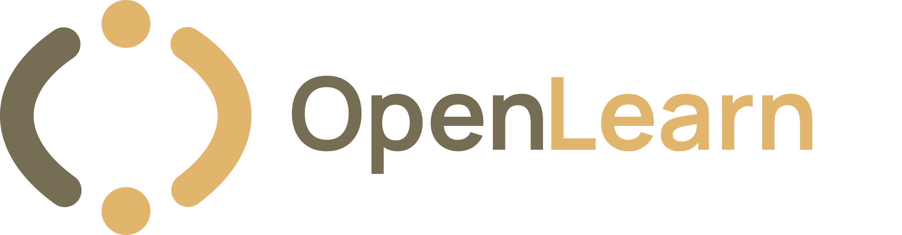

<div align="center">

<br>



<br>
<br>

**Open-source adaptive learning, without the vendor lock-in.**

<br>

[](LICENSE)
[](CONTRIBUTING.md)

<br>

[Docs](docs/) · [Architecture](docs/architecture/SystemArchitecture.md) · [Roadmap](planning/Roadmap/MASTER_ROADMAP.md) · [Contributing](CONTRIBUTING.md)

<br>

</div>

> **Status: pre-alpha.** Architecture, research, and design docs are in place; the backend, frontend, and services are under active construction and not yet runnable end-to-end. See [Development Status](#development-status) before opening issues about broken setup steps.

---

## What it is

OpenLearn AI turns study material — PDFs, slides, notes, scans — into an adaptive learning loop instead of a static chat window. It builds a model of what a learner actually understands, maps how concepts depend on each other, and uses both to decide what to study next and when to review it, before it's forgotten.

Every AI-facing component (LLM reasoning, embeddings, OCR, vector storage) sits behind a provider interface, so the same deployment can run fully offline, fully on managed cloud APIs, or any mix — a configuration choice, not a fork.

## Why this exists

Tools that "chat with your PDF" answer questions but remember nothing between sessions — no sense of what you struggle with, no concept dependencies, no review scheduling. The handful of products that do this well are closed-source, cloud-only, and priced for institutions, not individual students in underserved language markets.

|                                   | Chat-with-PDF tools | Closed adaptive platforms | OpenLearn AI |
| --------------------------------- | ------------------- | ------------------------- | ------------ |
| Tracks per-concept mastery        | ✗                   | ✓                         | ✓            |
| Prerequisite-aware study paths    | ✗                   | Partial                   | ✓            |
| Spaced repetition scheduling      | ✗                   | Sometimes                 | ✓            |
| Runs fully offline                | ✗                   | ✗                         | ✓            |
| Open source                       | ✗                   | ✗                         | ✓ (AGPL-3.0) |
| Arabic-first multilingual support | ✗                   | ✗                         | ✓            |

## Core capabilities

- Multi-format ingestion — PDF, DOCX, PPTX, images, OCR for scanned content
- Retrieval-augmented Q&A with citation-grounded answers, not just plausible text
- Auto-extracted knowledge graph of concepts and prerequisites
- Per-concept mastery tracking (starts heuristic, upgrades to Bayesian Knowledge Tracing as data accumulates)
- Adaptive engine that turns mastery + graph + learner profile into concrete study recommendations
- Spaced repetition scheduling driven by forgetting curves
- Generated flashcards, adaptive quizzes, and CAT-style exam simulation
- Learning analytics: progress, weak areas, readiness

Full detail: [Technical Specification](docs/design/OpenLearn_AI_v4_Technical_Specification.md).

## Deployment modes

One codebase, three presets:

| Mode       | AI runs                                     | Internet             | Typical hardware           |
| ---------- | ------------------------------------------- | -------------------- | -------------------------- |
| **Local**  | Entirely on-device                          | Not required         | 16 GB RAM, GPU recommended |
| **Hybrid** | Local core, cloud augmentation where useful | Only for cloud calls | 8 GB RAM                   |
| **Cloud**  | Entirely managed APIs                       | Required             | 4 GB RAM                   |

Mode profiles and hardware requirements: [deployment requirements](docs/design/OpenLearn_AI_System_Requirements_and_Deployment_Profiles.md) · user-facing edition: [install guide](docs/design/OpenLearn_AI_User_System_Requirements_Guide.md)

## Architecture, briefly

Content moves through ingestion → knowledge base → knowledge graph → student model → learner profile → adaptive engine → generation → analytics, with feedback loops that let every study session refine future recommendations. Nothing calls an AI provider directly — everything goes through a provider abstraction layer, so swapping a model or vendor is a config change, not a rewrite.

Diagrams and rationale: [`docs/architecture/SystemArchitecture.md`](docs/architecture/SystemArchitecture.md) · [`docs/architecture/DataFlow.md`](docs/architecture/DataFlow.md) · decisions: [ADRs](docs/adr/)

## Repository layout

```
backend/         FastAPI app (skeleton), tests  — future domain modules:
                 backend/app/services/{ingestion,ocr,embeddings,rag,...}
frontend/        Next.js 16 app (scaffold)
infra/           docker compose dev environment
docs/            design · architecture · adr · research (+ raw/, archive/)
planning/        44-week execution plan · roadmaps · sprints · team roles
experiments/     OCR benchmark + exploratory notebooks (never imported by product code)
presentations/   demo materials
```

Authoritative map of what-each-document-decides: [`docs/README.md`](docs/README.md).

## Getting started

There is no end-to-end product yet — don't file an issue if a quickstart is missing. The fastest way to get oriented right now:

1. Read [`AI_CONTEXT.md`](AI_CONTEXT.md) (current state) and the [Technical Specification](docs/design/OpenLearn_AI_v4_Technical_Specification.md).
2. For local development: backend (`backend/` + `infra/docker-compose.dev.yml`), frontend (`frontend/`, Node 20), OCR benchmark (`experiments/OCR/ocr-benchmark/`, needs `uv`) — see [`CONTRIBUTING.md`](CONTRIBUTING.md).
3. Check [Development status](#development-status) and the [44-week execution plan](planning/Roadmap/44-WEEK-EXECUTION-PLAN.md) for what's actively being built.

## Documentation map

Which document decides what: [`docs/README.md`](docs/README.md) (authority hierarchy).

| You want to...                                      | Go to                                                        |
| --------------------------------------------------- | ------------------------------------------------------------ |
| Get oriented in the current repository state        | [`AI_CONTEXT.md`](AI_CONTEXT.md)                             |
| Read the full technical design                      | [`docs/design/OpenLearn_AI_v4_Technical_Specification.md`](docs/design/OpenLearn_AI_v4_Technical_Specification.md) |
| See why a decision was made                         | [`docs/adr/`](docs/adr/)                                     |
| Check hardware/deployment requirements              | [`docs/design/OpenLearn_AI_System_Requirements_and_Deployment_Profiles.md`](docs/design/OpenLearn_AI_System_Requirements_and_Deployment_Profiles.md) |
| Understand the research basis (BKT, RAG, OCR, etc.) | [`docs/research/`](docs/research/)                           |
| Track progress                                      | [`planning/Roadmap/44-WEEK-EXECUTION-PLAN.md`](planning/Roadmap/44-WEEK-EXECUTION-PLAN.md) · sprints in [`planning/`](planning/) |
| Understand the OCR evaluation methodology           | [`experiments/OCR/OCR_BENCHMARKING_HANDBOOK.md`](experiments/OCR/OCR_BENCHMARKING_HANDBOOK.md) |

## Development status

Active, pre-alpha. Documentation and architecture are ahead of implementation by design — this is a deliberate spec-first approach, not neglect. Current engineering focus (Sprint 02): repository foundation cleanup and the OCR benchmark pipeline (ground truth → metrics → one engine → validate harness). Expect frequent breaking changes until v1.0.

## Contributing

Start here: [`CONTRIBUTING.md`](CONTRIBUTING.md) and [`CODE_OF_CONDUCT.md`](CODE_OF_CONDUCT.md).

Right now, the highest-value contributions are:
- The OCR benchmark pipeline (ground-truth annotation, metrics, engine adapters) in [`experiments/OCR/ocr-benchmark/`](experiments/OCR/ocr-benchmark/)
- Reviewing or proposing an [ADR](docs/adr/) for an open architectural question (e.g., the deferred vector-store decision)
- Backend/frontend tasks listed in the current [sprint](planning/Sprint-02.md)

Avoid opening large, unscoped PRs — module boundaries are intentional; check the relevant ADR before restructuring anything.

## License

[AGPL-3.0](LICENSE).
